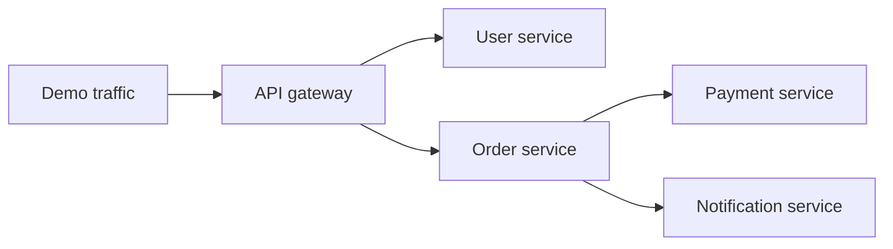
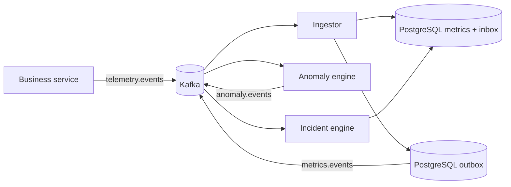
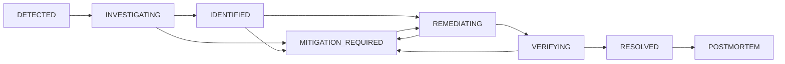
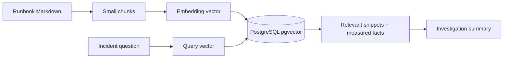
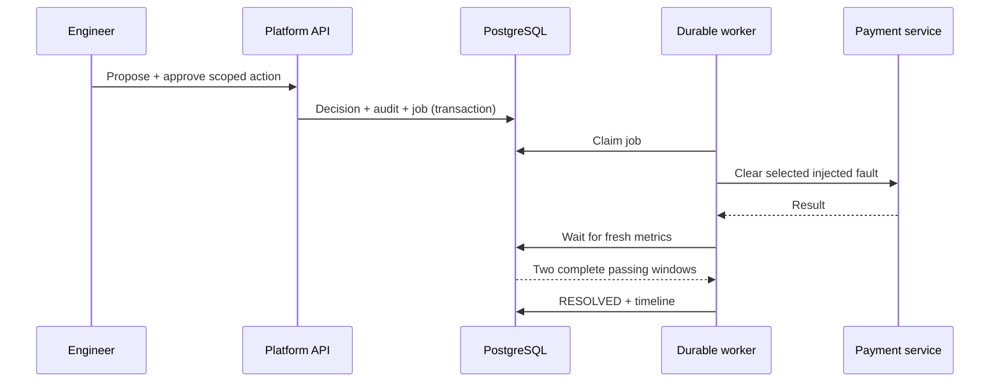

# SentinelOps ko samjho: zero se architecture tak

> **Ek guided course, sirf project description nahi.** Is guide ko chapter order mein padho, local demo dekho, phir linked source kholkar har claim verify karo. Language Hinglish hai; technical words English mein rakhe hain taaki code aur documentation se match ho.

**Current scope:** 13 October 2026 ko verified **local demo**. Repair work branch `codex/local-demo-hardening-2026-10-13` par push hua hai; `main` mein merge hona alag step hai. Production deployment abhi nahi hua. [Final evidence](FINAL_CHECK_2026-10-13.md) · [Six-phase checklist](FIX_PLAN.md) · [Implemented architecture](architecture/IMPLEMENTED_ARCHITECTURE.md)

---

## Is course ko kaise use karein

| Level | Chapters | Tum kya samjhoge | Apna proof |
| --- | --- | --- | --- |
| 🌱 Foundation | 1–4 | Product, web request, microservices, stack | System ko kisi friend ko 2 minutes mein explain karo |
| 🔍 Follow the signal | 5–8 | Repo, Docker, traffic, telemetry, Kafka | Ek metric ka source se database tak route trace karo |
| 🧠 Reason and act | 9–13 | Detection, incidents, AI, approvals, recovery | Fault inject karke incident ka complete journey dekho |
| 🛠️ Engineer's view | 14–18 | Before/after repairs, tests, limits, production path | Har major change ka reason aur failure mode batao |

**Reading rule:** `design/target` aur `running/implemented` ko mix mat karna. Purana [ARCHITECTURE.md](architecture/ARCHITECTURE.md) vision bhi dikhata hai. Running behavior ke liye [IMPLEMENTED_ARCHITECTURE.md](architecture/IMPLEMENTED_ARCHITECTURE.md), source code, aur [final check](FINAL_CHECK_2026-10-13.md) ko priority do. Code links isi guide se relative hain.

---

## Chapter 1 — Hum bana kya rahe hain?

Socho ek online shop hai. Customer order karta hai. Website ke peeche alag services user, order, payment aur notification sambhalti hain. Payment slow ho jaaye to customer ko bas “loading” dikhega; engineer ko jaldi samajhna hai **kya slow hai, kahan se shuru hua, aur fix ke baad sach mein theek hua ya nahi**.

**SentinelOps us shop ka software-system doctor hai.** Iska loop:

1. Services ka behavior measure karo: requests, latency, errors, CPU, queue.
2. Us service ke normal behavior se compare karo.
3. Related unusual measurements ko ek incident mein jodo.
4. Evidence aur runbook ke saath likely cause samjhao.
5. Engineer se scoped action approve karwao.
6. Demo fault clear karo; **fresh measurements** se recovery verify karo.
7. Timeline aur postmortem likho, taaki incident se seekh sakein.

**Real-life analogy:** Hospital monitor heart rate dikhata hai (telemetry); doctor high reading ko normal range se compare karta hai (detection); kai symptoms ko ek case mein jodta hai (correlation); treatment suggest karta hai (investigation); trained person treatment authorize karta hai (approval); baad ki readings se improvement check hota hai (verification). Monitor ki ek noisy reading par surgery nahi hoti—isi liye SentinelOps bhi repeated samples aur human approval use karta hai.

**Important honesty:** Shop ki HTTP calls aur measured timings real hain. Demo business DB/cache operations simulated delays/counters hain. Kafka, PostgreSQL, Redis, dashboard, incident records aur monitoring real running components hain. Local demo mein executable remediation **named injected fault ko clear karna** hai; real service restart, scale, rollback aur cache clear executors abhi nahi hain.

> **Checkpoint 1:** Agar payment request slow ho, “dashboard red hai” se zyada useful answer kya hoga? Service, metric, baseline, time, related services, suspected cause, approved action aur recovery evidence bolo.

## Chapter 2 — Sabse pehle web ka basic model

Browser HTTP **request** bhejta hai; server **response** deta hai. `GET` data padhta hai, `POST` action maangta hai. Ek service dusri service ko bhi HTTP se call kar sakti hai. `localhost` tumhare apne computer ko refer karta hai; **port** us computer par particular program ka door number hai.

Example: dashboard `http://localhost:3000` browser page deta hai. Us page ka API call `http://localhost:4010/api/incidents` platform API tak jaata hai. `4010` host port hai; Docker ke andar API `4000` par sunta hai. Agar login token nahi ho, incident list request `401 Unauthorized` hoti hai. [API entry point](../apps/api/src/index.ts) · [Browser API client](../apps/web/lib/api.ts) · [Demo port mapping](../.env.demo.example)

**Microservice** ka matlab: alag responsibility wale programs. Ek order service payment service ko call karti hai; agar payment slow hua, order bhi slow nazar aa sakta hai. Isliye ek symptom ko root cause samajhna galat ho sakta hai.



Is graph ko code mein [gateway](../services/api-gateway/src/app.ts), [order](../services/order-service/src/app.ts), aur [payment](../services/payment-service/src/app.ts) par follow karo. `loadgen` customer ki tarah regular traffic bhejta hai, taaki normal baseline seekhne ke liye data aaye. [Load generator](../services/loadgen/src/index.ts)

**Data plane** = monitored five business services, yani “patient”. **Control plane** = ingestor, detector, incident engine, platform API aur worker, yani “doctor's workflow”. Dono ek local Compose stack mein chalte hain, lekin unki responsibilities alag hain.

> **Checkpoint 2:** Payment slow hone par order bhi slow kyun lag sakta hai? Kyunki order ka response payment ke response ka wait karta hai. Isi dependency ko incident correlation use karta hai.

## Chapter 3 — Stack dictionary: kaunsi technology kyun?

Pehle **runtime** samjho: code ko chalane wala environment. **Framework** common web plumbing deta hai. **Database** durable records rakhta hai. **Broker** programs ke beech messages pahunchata hai. **Container** reproducible packaged process hai. Ye cheezein ek dusre ka replacement nahi hain.

| Technology | Is project mein kaam | Kyun yahan? | Easy example |
| --- | --- | --- | --- |
| **TypeScript + Node.js** | Backend, shared libraries aur UI code ka runtime/language | Shared types aur one-language workflow se contracts samajhna easy | Form mein `amount` number expect ho, string bhejne par type check warning |
| **npm workspaces** | `apps/`, `services/`, `packages/`, `control-plane/` ko ek monorepo mein manage | Shared code aur ek lockfile | Ek campus mein departments, shared library sabko available |
| **Fastify** | Business services aur platform API ke HTTP routes | Small, explicit request/response handlers | Reception desk request ko right function tak bhejta hai |
| **Next.js + React** | Browser dashboard pages/components | Engineer incident dekh aur act kar sake | Control room screen; server ka replacement nahi |
| **Tailwind CSS + Zustand** | UI styling aur client-side auth state | Consistent style, small shared state | Dashboard ka paint aur login memory |
| **PostgreSQL** | Metrics, incidents, events, decisions, jobs, audit trail | Related records ko transaction mein durable rakhna | Hospital register; power loss ke baad bhi record |
| **pgvector** | Runbook chunks ke embeddings aur similarity search | Relevant guidance retrieve karna | Meaning se similar manual pages dhoondhna |
| **Redis** | Fast short-lived idempotency markers; demo cache dependency | Repeated message ko quickly recognize karna | Entry gate ka temporary stamped pass |
| **Apache Kafka** | Telemetry/anomaly/incident events ke topics | Producers aur consumers independently kaam karte hain | Postal sorting center; message baad mein bhi process ho sakta hai |
| **OpenTelemetry** | Request traces, metrics, app logs export | “Request kahan-kahan gayi?” observe karna | Parcel ka tracking ID |
| **Prometheus + Grafana** | Time-series scrape/queries aur dashboards | Fleet aur SentinelOps ki operating health | Gauges + control-room graphs |
| **Jaeger + Loki** | Distributed traces + searchable application logs | Slow request path aur log context | Parcel route history + written diary |
| **Docker Compose** | Local multi-container startup, network, volumes, health gates | Poora demo reproducibly ek machine par chalana | Lab ke sab apparatus ko ek setup plan se on karna |
| **Vitest, ESLint, Prettier, TypeScript checks** | Behavior, rules, formatting, types verify | Change ke baad regressions pakadna | Machine ka checklist aur quality inspection |

**Trade-off:** Ek TypeScript monorepo local learning aur shared contracts ke liye practical hai. Runtime services phir bhi alag processes hain; ek language hone ka matlab ek giant application nahi. Backend shared Docker image mein production `tsx` se TypeScript source execute hota hai; dashboard optimized Next build se `next start` par chalta hai. [Dockerfile](../Dockerfile) · [Workspaces/scripts](../package.json)

**“Simple alternative kyun nahi?”** Chhote real product ke liye single backend aur direct HTTP calls kaafi ho sakte hain. Yahan goal distributed incident-response behavior ko **seekhna aur demonstrate** karna hai: asynchronous delivery, duplicate events, service dependency, failure recovery. Kafka extra operational complexity laata hai, lekin isi failure mode ko study karne deta hai. PostgreSQL durable history ke liye hai; Redis quick markers ke liye. Agar sab data Redis mein rakho, audit/history semantics weak ho jayengi; agar har temporary marker PostgreSQL mein rakho, fast cache ka purpose chala jayega. Ye project-specific choices hain, universal rule nahi.

**Installed ≠ implemented:** Dependency list mein library dikhna uske UI mein active use ka proof nahi. Isi tarah architecture design mein Python/Isolation Forest ka mention current Python detector ka proof nahi. Running detector TypeScript ka statistical z-score detector hai.

> **Checkpoint 3:** Kafka aur PostgreSQL dono kyun? Kafka “kisko next batana hai” queue karta hai; PostgreSQL “incident ka durable sach kya hai” store karta hai. Redis ko incident history database mat samajhna.

## Chapter 4 — Repository ka map

```text
SENTINELOPS/
├─ apps/web/             Browser dashboard (Next.js)
├─ apps/api/             Platform API, auth, decisions, recovery worker
├─ services/             Monitored business services + load generator
├─ control-plane/        Ingestor, anomaly engine, incident engine, event tap
├─ packages/             Shared types, Kafka/DB helpers, algorithms, AI/RAG
├─ infrastructure/db/    Database migrations
├─ infrastructure/docker/ Local databases, broker, monitoring
├─ monitoring/           Collector, Prometheus, Grafana, Loki configs
├─ docs/                 Design, review, repair evidence, this course
├─ docker-compose.yml    Complete local demo wiring
└─ scripts/stack-smoke.mjs  End-to-end demo test
```

**How to read code without “vibe coding”:** Har feature ke liye chaar sawaal pucho: *input kahan se aata hai? validation kahan hoti hai? state kahan save hoti hai? failure par kya hota hai?* Example: [shared event schema](../packages/shared-types/src/events.ts) → [Kafka consumer](../packages/kafka/src/consumer.ts) → [ingestor](../control-plane/ingestor/src/index.ts) → [Postgres migration](../infrastructure/db/migrations/0001_init.sql). Ek file padhkar system ka behavior assume mat karo.

## Chapter 5 — Local setup aur Docker ko sach mein samjho

`Dockerfile` **image** banata hai (recipe). `docker-compose.yml` batata hai kaunse **containers** chalenge, kis network/port/volume ke saath. Container process disposable ho sakta hai; **named volume** database data ko restart ke baad bhi rakhta hai. [Full Compose](../docker-compose.yml) infra Compose ko include karta hai; [infra Compose](../infrastructure/docker/docker-compose.infra.yml) PostgreSQL, Redis, Kafka aur monitoring define karta hai.

Windows host par Docker Desktop ka large WSL data disk `D:\DockerDesktopData\DockerDesktopWSL` mein move kiya gaya, kyunki C: bhar raha tha. Data disk D: par hone ka matlab project code ko C: par move karna nahi. Docker ke chhote application files C: par reh sakte hain. **`docker compose down` named volumes preserve karta hai; `down -v` unhe delete karta hai.** Learning ke dauraan `-v` use mat karo jab tak data reset jaanbujhkar na karna ho.

```powershell
# Repo root: D:\miniProject\SENTINELOPS
npm ci
docker compose --env-file .env.demo.example up -d --build --wait
docker compose --env-file .env.demo.example ps
Invoke-RestMethod http://localhost:4010/api/ready
```

Expected API response: `{"ready":true}`. Dashboard `http://localhost:3000`; demo login README mein diya hai. Prometheus `:9090`, Grafana `:3001`, Jaeger `:16686`. `migrate` one-shot container successful exit ke baad rukta hai—uska `Exited (0)` normal hai. Final check mein 21 long-running containers the; 12 ke Docker healthchecks configured hain. “Running” har service ke actual function ka proof nahi, isliye API readiness aur smoke test bhi karte hain. [Startup wiring](../docker-compose.yml) · [Final live results](FINAL_CHECK_2026-10-13.md)

> **Checkpoint 5:** Container recreate ho aur incident history bachi rahe, to kyun? PostgreSQL named volume container se separate hai. Volume delete karne par situation badal jaati hai.

## Chapter 6 — Ek customer request se measurement tak

`loadgen` API gateway ko requests bhejta hai. Gateway user/order ko call karta hai; order payment/notification ko. [Shared service kit](../packages/service-kit/src/server.ts) routes, health, faults, metrics aur logging setup karta hai. Demo payment ka `simulateDbQuery()` actual business DB charge insert nahi karta; timing/fault simulation karta hai. Is distinction se tum “real telemetry” ko “real payment processing” na samjho. [Payment code](../services/payment-service/src/app.ts)

**Metric** = time ke saath numeric measurement, jaise `http_request_duration_ms=75`. **Log** = event ka text/context, jaise request fail hui. **Trace** = ek request ka multiple services mein path. `traceId` ko parcel tracking number samjho. Ek slow request ka trace gateway → order → payment dikha sakta hai; metric bolta hai “payment latency badhi”; log reason ka clue de sakta hai.

Service kit raw counters/histograms ko lagbhag 5-second **interval samples** mein badalta hai. Cumulative request count se rate calculate karta hai; request histogram ke naye `sum` aur `count` se interval average latency nikalta hai. `/health`, `/metrics`, `/admin` traffic ko application rate se exclude karta hai—warna monitoring apni requests se chart ko distort kar degi. [Interval sampler](../packages/service-kit/src/telemetry-publisher.ts)

Sample event ka **illustrative** shape (fields code schema se liye gaye hain; value example hai):

```json
{
  "eventId": "unique-uuid",
  "type": "TELEMETRY_SAMPLE",
  "timestamp": "2026-10-13T15:00:00Z",
  "service": "payment-service",
  "version": 1,
  "payload": {
    "samples": [{ "metric": "db_query_latency_ms", "value": 2000, "ts": "2026-10-13T15:00:00Z", "labels": { "instance": "demo" } }]
  }
}
```

`eventId` replay ko pehchanne mein, `service` routing/grouping mein, `timestamp` ordering mein, aur `version` future contract changes mein help karta hai. Actual schema: [events.ts](../packages/shared-types/src/events.ts).

## Chapter 7 — Kafka aur PostgreSQL: message ka safe journey



**Topic** ko named inbox samjho. Business service `telemetry.events` par sample bhejti hai. [Ingestor](../control-plane/ingestor/src/index.ts) schema validate karke `metrics` table mein save karta hai, phir normalized `metrics.events` bhejta hai. [Anomaly engine](../control-plane/anomaly-engine/src/index.ts) **sirf normalized metrics topic** consume karta hai; raw aur normalized dono se ek sample ko do baar count karna purana defect tha.

Distributed systems ka core problem: message aaya, database write hua, process crash ho gaya, Kafka ne message phir deliver kar diya. **At-least-once** ka matlab duplicate possible hai. Isko safe banane ke liye:

| Mechanism | Kya karta hai | Notebook analogy |
| --- | --- | --- |
| **Inbox** | `(consumer, eventId)` ko DB transaction mein business write ke saath save karta hai; same event phir aaye to skip | Parcel received stamp |
| **Transaction** | Work fail ho to inbox stamp aur data write dono rollback | Ek receipt par saari entries ya koi nahi |
| **Outbox** | DB change aur “next event bhejna hai” ek transaction mein save karta hai | Dispatch diary mein letter record |
| **Dispatcher** | Outbox se Kafka send confirm hone ke baad row published mark karta hai | Courier confirmation ke baad diary tick |
| **DLQ** | Repeatedly invalid/failing message ko dead-letter topic mein original payload ke saath rakhta hai | Exception shelf, silent trash nahi |

[Database reliability helpers](../packages/db/src/reliability.ts) aur [Kafka consumer](../packages/kafka/src/consumer.ts) padho. Redis ka fast duplicate marker completion ke **baad** set hota hai. DB inbox restart ke across durable correctness deta hai. Kafka send aur SQL commit ek global atomic transaction nahi hain; crash timing se same event phir aa sakta hai. Design ka promise **idempotent effects with at-least-once delivery** hai, magical “exactly once everywhere” nahi. Telemetry publication best effort hai; control-plane state/delivery ko stronger protection di gayi hai.

> **Checkpoint 7:** Agar event DB mein save hua, lekin Kafka ack se pehle worker gira, replay se duplicate incident kyun nahi banna chahiye? Same `eventId` ka inbox record already committed hoga.

## Chapter 8 — Detection: “abnormal” ka mathematical matlab

Detector har `(service, metric, instance)` series ka rolling **baseline** rakhta hai. Pehle 12 healthy samples **warmup** hain. Uske baad recent mean (`average`) aur standard deviation (`normal variation`) se z-score nikalta hai:

```text
z = (new value - baseline mean) / max(std deviation, 5% of |mean|, tiny floor)
```

Default upward anomaly threshold `z >= 3` hai. Lekin statistics alone kaafi nahi: small jitter bhi flat baseline par huge z de sakta hai. Isliye metric-specific **absolute noise floor** bhi hai. HTTP latency ka current local floor **25 ms** hai. Baseline lagbhag 58 ms ho to 71/75 ms ordinary change ignored; 100 ms ke repeated abnormal samples alert ban sakte hain. HTTP/database/Redis latency ko 2 consecutive abnormal samples chahiye; CPU, memory, queue, request rate ko 3. Healthy sample ya 20-second se bada gap confirmation reset karta hai. [Detector](../packages/detection/src/detector.ts) · [Noise floors](../packages/shared-types/src/enums.ts) · [Regression example](../packages/detection/src/noise.test.ts)

Anomalous samples baseline ko train nahi karte. Varna prolonged outage dheere-dheere “new normal” ban jaayegi. Detector state DB mein persist hoti hai, isliye restart ke baad warmup/confirmation randomly reset nahi hote. **Anomaly score confidence of truth nahi hai**; ye rule ke andar normalized severity signal hai. Local thresholds universal production settings nahi hain.

> **Checkpoint 8:** Ek single 100 ms reading ko turant incident kyun nahi banana? Noisy/temporary spike ho sakti hai. Do confirmed samples aur 25 ms floor false alarms kam karte hain; severe-but-short events ke liye trade-off samajhna zaroori hai.

## Chapter 9 — Correlation aur root cause: alarms ko case mein badalna

Payment latency, order latency aur payment error rate alag alerts ho sakte hain, par customer ko ek hi problem hai. [Correlator](../packages/correlation/src/correlator.ts) anomalies ko roughly **60-second activity window** aur dependency graph ke **up to 2 hops** ke basis par group karta hai. Group ko `correlationId` milta hai; [incident engine](../control-plane/incident-engine/src/processor.ts) `INC-...` record, affected services, severity, timeline aur suspected cause save karta hai. [Root-cause ranker](../packages/root-cause/src/engine.ts) evidence aur dependency direction se hypotheses rank karta hai.

**Example:** Order → Payment dependency hai. Agar pehle payment DB latency bigdi aur phir order responses slow hue, payment likely source ho sakta hai. Lekin “likely” certainty nahi: network, unknown downstream, ya simultaneous fault bhi ho sakta hai. Isi liye incident detail par measured evidence dikhana important hai.

Time bhi engineering problem hai. Kafka messages order se late aa sakte hain. Correlation state ka watermark PostgreSQL mein persist hota hai; bahut purane events ko new incident mein jodne ke badle archive kiya jata hai. Future timestamp beyond allowance reject hota hai. Ye safeguards stale data se galat live incident banne ko rokte hain, par live multi-region clock behavior abhi production-verified nahi. [Current limits](architecture/IMPLEMENTED_ARCHITECTURE.md)

> **Checkpoint 9:** “Affected service” aur “root cause service” same hone zaroori hain? Nahi. Order affected ho sakta hai, payment root cause candidate ho sakta hai.

## Chapter 10 — Incident state machine aur durable history

**State machine** allowed steps ki list hai. Incident arbitrary label jump nahi kar sakta:



`DETECTED` ka matlab signal mila; `INVESTIGATING` mein engineer/evidence review; `MITIGATION_REQUIRED` mein decision chahiye; `REMEDIATING` action in progress; `VERIFYING` fresh metrics ka wait; `RESOLVED` recovery proven; `POSTMORTEM` learning record generated. `IDENTIFIED` tab aa sakta hai jab investigation ke paas suspected root cause ho. [Allowed transitions](../packages/shared-types/src/enums.ts) · [Transactional transition helper](../packages/db/src/lifecycle.ts)

Kyun transaction? Socho UI par `RESOLVED` aa gaya, par timeline/audit message missing hai. Investigation mein confusion hoga. Transition helper incident row lock karta hai, expected old status check karta hai, status + timeline + outbox ko transaction mein likhta hai. PostgreSQL schema [migrations](../infrastructure/db/migrations/0001_init.sql) mein `incidents`, `incident_events`, `anomalies`, `remediation_actions`, `audit_log` jaise tables hain. **Timeline append** future debugging ke liye evidence hai; UI ke current status ka substitute nahi.

**Trade-off:** Correlation aur outbox ke global locks local correctness ke liye simple hain, lekin high-throughput, many-replica production scale par bottleneck ho sakte hain.

## Chapter 11 — “AI” aur RAG ka actual role

Yahan AI detector nahi hai. Numeric alert **deterministic TypeScript rules** se aata hai. Investigation ke waqt API incident anomalies, ranked cause, recent deployment info aur [runbooks](runbooks/) collect karta hai. RAG ka full form **Retrieval-Augmented Generation** hai: answer se pehle relevant reference text dhoondo.



Embedding ko “text ka numeric fingerprint” samjho. Nearby fingerprints ka matlab roughly related text. Default local embedder **deterministic feature hashing** use karta hai; remote embedding/LLM calls ke liye explicit config/credentials chahiye. [Runbook indexing](../apps/api/src/runbooks.ts) · [Embeddings](../packages/rag/src/embeddings.ts) · [pgvector retriever](../packages/rag/src/retriever.ts)

Default LLM provider **mock** hai: no API key, no external model reasoning. Remote provider select karo to model se sirf known evidence/runbook IDs choose karwaye jaate hain; returned IDs validate hote hain, aur published summary trusted facts se banti hai. Malformed output/provider failure par deterministic evidence fallback hai. Isse free-form hallucinated telemetry ko record mein publish karne ka risk kam hota hai. “AI-powered” product direction samjho, local demo mein magical autonomous diagnosis nahi. [Provider](../packages/ai/src/provider.ts) · [Investigator](../packages/ai/src/investigator.ts)

> **Checkpoint 11:** RAG aur model same cheez hain? Nahi. Retriever relevant source dhoondta hai; model us context ke basis par response banata/selection karta hai. Default local provider model API ko call hi nahi karta.

## Chapter 12 — Login, permissions, approval aur recovery

Dashboard login se API **JWT** deta hai—signed token jo user identity/role carry karta hai. **RBAC** (role-based access control) decide karta hai kaun kya kar sakta hai: `VIEWER` read-only, `ENGINEER`/`ADMIN` investigation, fault mutation aur decision kar sakte hain. API REST reads bhi protected hain. Browser WebSocket token/origin check karta hai, token expiry par connection band karta hai; socket fail ho to UI polling se refresh kar sakti hai. [Auth](../apps/api/src/auth.ts) · [WebSocket](../apps/api/src/event-socket.ts) · [Browser live events](../apps/web/lib/live-events.ts)

Demo mein **Failure Console** payment-service ka `db_latency` fault inject karta hai. [Failure route](../apps/api/src/routes/failures.ts) role aur known fault target check karta hai, phir internal token se service admin endpoint call karta hai. `DEMO_MODE` ke bahar direct fault administration disabled hai. Yeh intentionally isolated lab behavior hai.

Investigation ke baad [remediation route](../apps/api/src/routes/remediation.ts) known **currently active** injected fault ke liye `clear_injected_fault` action propose karta hai. Engineer approval action row, unique decision, audit record aur **durable job** DB mein save karta hai. Duplicate approval reject hota hai. Worker [job](../apps/api/src/remediation-worker.ts) pick karta hai; [executor](../packages/remediation/src/executor.ts) sirf selected fault ko bounded internal HTTP request se clear karta hai. Restart/scale/rollback suggestions real actions execute nahi karte.

Action complete hona recovery ka proof nahi. [Verifier](../packages/remediation/src/recovery.ts) fault ke **baad ke fresh, complete observations** maangta hai: incident ke affected service/metric/instance series, baseline tolerance, aur **two passing windows**. Missing/stale evidence ya timeout ho to `MITIGATION_REQUIRED` par wapas jata hai. **Real-life analogy:** doctor dawa dene ke baad patient ki nayi readings dekhta hai; purani normal report dikhakar “cured” nahi bolta.



> **Checkpoint 12:** HTTP `200` from “clear fault” ko `RESOLVED` kyun nahi maan sakte? Action accepted hone aur actual service behavior normal hone mein difference hai.

## Chapter 13 — Observability ke do parallel raaste

**Incident pipeline:** service-kit → Kafka → ingestor/Postgres → anomaly engine → incident engine. **Operations monitoring:** service OpenTelemetry/`/metrics` → collector/Prometheus/Jaeger/Loki → Grafana. Dono data sources help karte hain, lekin detector Prometheus screenshot dekhkar alert nahi banata; wo normalized Kafka metric samples consume karta hai.

| Question | Tool | Is project mein kya dekho |
| --- | --- | --- |
| “Kitni requests/errors/latency?” | Prometheus `:9090` | Scrape targets aur time-series queries |
| “Graphs ek screen par?” | Grafana `:3001` | Provisioned dashboard; Prometheus/Loki sources |
| “Ek request kahan slow hui?” | Jaeger `:16686` | Gateway/order/payment spans |
| “Service ne kya log likha?” | Loki `:3100` via Grafana | Structured application log stream |
| “SentinelOps khud alive?” | `/metrics`, `/api/ready`, Docker health | Pipeline/API operational state |

[OTel collector routing](../monitoring/otel/otel-collector-config.yaml) traces Jaeger ko, metrics Prometheus-readable endpoint ko, logs Loki ko bhejti hai. [Prometheus scrape config](../monitoring/prometheus/prometheus.yml) services aur control plane dono ko scrape karta hai. Business services ka OTel export best effort hai: collector unavailable ho to business service boot kar sakti hai. Incident pipeline ka PostgreSQL evidence aur observability UI alag responsibility rakhte hain.

> **Checkpoint 13:** Jaeger trace aur PostgreSQL incident mein difference? Trace ek request ki journey hai; incident multiple signals/time ka durable operational case hai.

## Chapter 14 — Pehle kya tha, humne kya badla?

9 October [review](PROJECT_REVIEW_2026-10-09.md) ek **historical snapshot** hai, current bug list nahi. Us waqt TypeScript checks pass hone ke baad bhi Next production build fail hota tha; coverage ~22% thi; Docker engine unavailable tha; event/recovery safety gaps the. [Phase plan](FIX_PLAN.md) ne repairs ko six stages mein organize kiya. Neeche concrete before → after map hai:

| Phase | Pehle risk | Ab local demo mein kya hai | Kya principle seekho |
| --- | --- | --- | --- |
| **1. Run/build** | Web production import/build fail; image/workspace/monitor config mismatch | Next build, shared image, health gates, web/API/collector checks | “Typecheck passed” ≠ application runs |
| **2. Events/state** | Duplicate handling completion se pehle; publication errors hide; state writes partial | Inbox/outbox, strict send/DLQ, locked transactional state, migrations | Failure ke beech crash socho |
| **3. Access/action** | Direct fault endpoints, unauthenticated socket, duplicate approval, stale recovery | Demo-mode guards, JWT/RBAC, audited unique approval, durable worker, fresh-window verification | Action aur verified outcome alag |
| **4. Signals/investigation** | Metric double sampling, coarse windows, in-memory retrieval, noisy alerts | Normalized single feed, interval samples, persisted baselines, pgvector retrieval, calibrated confirmations | Bad input se clever AI bhi wrong hoga |
| **5. Deployment** | Persistence/startup assumptions weak; cloud config insecure defaults | Local Compose/Kustomize improvements, migration gates, stronger Terraform defaults | Rendered config ≠ production proof |
| **6. Proof/docs** | Thin tests, no live full-loop proof | 230 tests, coverage gates, live fault→postmortem smoke, final observation/report | Test + real running check dono chahiye |

Final noise example especially instructive hai: ek 5-minute quiet window ke baad bhi order HTTP latency ka background incident aaya. Humne 5 ms → 25 ms local floor kiya, regression test add ki, final image deploy ki, aur **8 min 31 sec** normal traffic observe kiya: 4,080 samples, zero anomalies, zero new incidents. Ye evidence tested workload ke liye hai, universal false-positive guarantee nahi. [Final check](FINAL_CHECK_2026-10-13.md)

**Docker/host fix:** C: almost full tha. Docker Desktop WSL data VHD D: par move hua; purana C: VHD gaya, named volumes preserve hue. Move ke restart par Redis append-only log ka 107-byte corrupt tail repair hua, pehle D: par backup liya gaya. Bina backup ke data repair risky hota. Host/storage engineering bhi project reliability ka part hai.

## Chapter 15 — Tests ko engineer ki tarah padho

Test count badge nahi, **claim ka evidence** hai. Unit test ek function ka rule verify karta hai; integration test modules ke interaction; live smoke running stack ka end-to-end path. Example [noise test](../packages/detection/src/noise.test.ts) ordinary jitter ignore aur sustained spike detect dono verify karta hai. [Smoke script](../scripts/stack-smoke.mjs) login, invalid fault rejection, fresh incident, investigation, approval, duplicate rejection, verified recovery aur postmortem exercise karta hai.

**Code-review habit:** Naya feature dekhte waqt sirf happy-path screenshot mat lo. Ek normal case, ek invalid input, ek duplicate/retry, ek process restart, ek permission-denied, aur ek missing-telemetry case socho. Test suite har hypothetical failure prove nahi karti, par ye questions review ko focused banate hain.

```powershell
$env:TEMP='D:\miniProject\SENTINELOPS\tmp\vitest-review'
$env:TMP=$env:TEMP
npm run test:coverage
npm run typecheck
npm run lint
npm run format:check
npm run build
```

Final pass: **49 test files, 230 tests**; statement 86.46%, branch 77.36%, function 80.62%, line 88.30%; configured gates pass. One full run host contention se time out hua; clean rerun pass hua. Coverage ka matlab 86% correct code nahi—sirf measured source execution. Branch coverage lower ho to untested decisions par focused tests chahiye. Dependency audit final check par zero known advisories tha; audit time-sensitive hai. [Detailed evidence](FINAL_CHECK_2026-10-13.md)

## Chapter 16 — Hands-on learning lab: ek incident khud trace karo

Ye commands **isolated local demo** ke liye hain. Running project root se:

1. `docker compose --env-file .env.demo.example ps` dekho. `migrate` ka successful exit normal hai. `Invoke-RestMethod http://localhost:4010/api/ready` mein `ready: true` expect karo.
2. `http://localhost:3000` kholo. [README](../README.md) ka demo engineer login use karo. **Failure Console → Increase DB Latency** select karo, `payment-service` target choose karo.
3. **Incidents** mein naya record kholo. Anomaly ka `metric`, `value`, `baseline`, time aur affected services note karo. [Detector](../packages/detection/src/detector.ts) mein decide karo trigger kyun hua.
4. **Run AI investigation** click karo. Root cause aur retrieved runbooks ko “hypothesis + references” ki tarah padho. [Investigation route](../apps/api/src/routes/incidents.ts) mein dekho context kahan se aaya.
5. **Propose remediation → Approve**. Action `clear_injected_fault` aur exact target/fault type check karo. [Decision route](../apps/api/src/routes/remediation.ts) mein DB transaction aur audit write follow karo.
6. `VERIFYING` se `RESOLVED` tak wait karo. Fresh samples aur two-window rule [worker](../apps/api/src/remediation-worker.ts) mein follow karo. Phir postmortem generate karo.
7. Prometheus mein payment metric trend, Jaeger mein request path, Grafana/Loki mein logs compare karo. Ek UI event ko multiple evidence sources se corroborate karna seekho.

Automated equivalent:

```powershell
$env:SENTINELOPS_SMOKE_URL='http://127.0.0.1:4010'
node scripts/stack-smoke.mjs
```

Script naya demo fault/incident banata aur clear karta hai; kuch minutes lag sakte hain. Manual lab mein fault active reh jaaye to Failure Console se clear karo. Historical incidents delete/auto-close mat karo: unka review alag operational decision hai.

**Read-only database exploration** (agar SQL seekhna chahte ho):

```powershell
docker exec sentinel-postgres psql -U sentinel -d sentinelops -c "SELECT status, count(*) FROM incidents GROUP BY status ORDER BY status;"
docker exec sentinel-postgres psql -U sentinel -d sentinelops -c "SELECT id, status, detected_at FROM incidents ORDER BY detected_at DESC LIMIT 5;"
```

Ye `SELECT` commands data nahi badalte. Final check ke waqt 46 old `DETECTED`, 1 `MITIGATION_REQUIRED`, 5 `POSTMORTEM` records the; live traffic/your experiments ke baad counts change ho sakte hain.

## Chapter 17 — Production se pehle ka syllabus

Local demo complete ka matlab internet-facing production ready nahi. Is gap ko honestly samajhna “vibe coding” se bahar aane ka essential part hai.

| Area | Aaj ki state | Production ke liye kaunsi proof/work chahiye |
| --- | --- | --- |
| Business integration | DB/cache operations largely simulated | Real applications, auth/data contracts, safe failure injection boundaries |
| Remediation | Named demo fault clear hota hai | Real restart/scale/rollback adapters, idempotency, rollback, approval policy |
| AI | Local mock provider/embedding default | Chosen remote model evaluation, cost/privacy, prompt-injection handling, source-quality review |
| Infrastructure | Compose live; Kubernetes manifests render; Terraform hardening source mein | Target cloud account/region, validated plan, secrets, TLS/network policy, registry images, backups/restore drill |
| Scale/reliability | Single local broker/locks, at-least-once design | Multi-partition crash/replay, load benchmarks, consumer lag, retention/DR, lock contention |
| Security/operations | Local demo credentials and loopback ports | Production identity, secret rotation, monitoring auth, incident ownership, historical backlog disposition |

Before production, workload, cloud provider/region, data sensitivity, uptime objective, traffic volume, on-call model aur budget decide karne honge. Phir threat model, deployment plan, rollback plan, migrations, secrets, backup restore, load test, staged rollout aur monitoring acceptance define karenge. Existing [Terraform](../infrastructure/terraform/README.md) aur [Kubernetes](../infrastructure/kubernetes/README.md) ko deployed proof mat samjho. Production phase ke liye ye syllabus hai, current completion claim nahi.

## Chapter 18 — Glossary, self-test, aur next reading route

**Suggested 7-day pace:** Day 1 chapters 1–3 aur browser request; day 2 chapters 4–6 aur repo walk; day 3 chapters 7–8 aur metric trace; day 4 chapters 9–11 aur incident/RAG; day 5 chapters 12–13 aur manual fault lab; day 6 chapters 14–16 aur tests; day 7 chapter 17, glossary, aur niche ke self-test. Har day ek diagram khud banao; copied diagram se kam, khud ke arrows se zyada seekhoge.

| Word | Seedha meaning |
| --- | --- |
| **API** | Defined request/response interface |
| **Baseline** | Ek series ka learned normal measurement |
| **Anomaly** | Rule se confirmed unusual metric sample |
| **Incident** | Related anomalies ka durable operational case |
| **Latency** | Kaam complete hone mein laga time |
| **Idempotent** | Same operation replay ho to duplicate effect na ho |
| **Transaction** | Group of DB writes: sab commit ya sab rollback |
| **Inbox/outbox** | Duplicate incoming event aur pending outgoing event ke durable ledgers |
| **JWT/RBAC** | Signed login identity / role-based permission |
| **Trace/span** | Request journey / us journey ka ek timed step |
| **RAG/embedding** | Answer se pehle references retrieve karna / text ka numeric representation |
| **Readiness vs liveness** | Kaam serve kar sakta hai? / process zinda hai? |
| **SLO** | Production mein agreed measurable reliability target; abhi define karna baaki |

**Khud se jawab likho (code kholkar):**

1. `telemetry.events` aur `metrics.events` dono kyun? Detector dono kyun nahi consume karta?
2. Kafka message replay hone par inbox, Redis marker aur outbox ka sequence kya hai?
3. 58→75 ms aur 58→100 ms HTTP latency mein current local rule ka difference kya hai?
4. Payment fault clear request successful hone par incident `RESOLVED` instantly kyun nahi?
5. Mock AI kya kar sakta hai, aur kya claim nahi kar sakta?
6. `docker compose down` aur `down -v` mein data ke liye kya difference hai?
7. User dashboard se approval deta hai: browser se worker tak ka path kaunse files mein hai?
8. Kaunsi three things local pass hui hain, lekin production ke liye phir validate karni hongi?

**Answer path:** 1–2 ke liye [ingestor](../control-plane/ingestor/src/index.ts), [anomaly engine](../control-plane/anomaly-engine/src/index.ts), [reliability helpers](../packages/db/src/reliability.ts); 3 ke liye [detector](../packages/detection/src/detector.ts); 4 aur 7 ke liye [API routes](../apps/api/src/routes/remediation.ts) aur [worker](../apps/api/src/remediation-worker.ts); 5 ke liye [AI provider](../packages/ai/src/provider.ts); 6 ke liye [Compose](../docker-compose.yml); 8 ke liye [final report](FINAL_CHECK_2026-10-13.md).

> **Graduation test:** Tum architecture ko diagram ke bina explain kar pao; ek incident ko browser se Kafka, PostgreSQL, approval aur verification tak trace kar pao; aur kisi feature ke liye “implemented, tested, simulated, ya future?” confidently bol pao. Tab production design discussion mein tum code ko question karoge, sirf generate nahi karoge.
