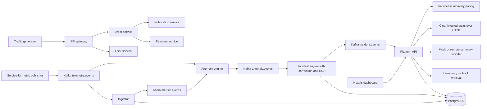

# SentinelOps architecture and verification review

Review date: 9 October 2026 (Asia/Calcutta). Reviewed revision: `a56abdeb66dcb65c44dc5ced46bf55d30e07341e`.

## Assessment

SentinelOps is a substantial distributed-systems prototype with a sensible separation between monitored demo services and an incident-analysis pipeline. Its strongest parts are the shared TypeScript contracts, deterministic detection and root-cause logic, reusable service scaffolding, and explicit incident lifecycle. The current implementation does **not** establish production readiness or the documented complete incident-response loop. Several concrete code and deployment gaps exist independently of the unavailable local Docker engine.

Keep the overall design. Prioritize making delivery, lifecycle changes, remediation, and recovery reliable before adding more features or ML models. The claim that all phases are implemented and only Docker prevents completion is too strong.

This review inspected the source, ADRs, architecture documentation, migrations, deployment configuration, monitoring configuration, dashboard, and tests. Findings below distinguish executed checks from conclusions reached by tracing code. No application fixes, deployments, external messages, or cloud provisioning were performed. Secret values in `.env` were not read or included.

## Verification results

| Check | Result | What it establishes |
| --- | --- | --- |
| `npm run typecheck` | Pass | Included backend and shared-package sources typecheck. Root config excludes tests and does not include dashboard `.tsx` pages. |
| `npx tsc --noEmit -p apps/web/tsconfig.json` | Pass | Dashboard has a separate successful TypeScript check. This check is absent from CI. |
| `npm run build -w @sentinelops/web` | Fail; source defect confirmed on retry | First run hit output-directory `EPERM`. A retry outside restricted execution reached webpack and failed to resolve `./api.js` imported by `lib/useApi.ts`. Next.js version: 15.5.25. |
| `npm run lint` | Pass | Configured lint rules pass; `apps/web/**` is explicitly excluded. An ESM package-metadata warning is emitted. |
| `npm run format:check` | Pass before report creation | Existing repository formatting passes. |
| `npm test` | Pass | 8 files, 41 unit tests. Mostly pure algorithm tests. |
| Coverage measured by Vitest | 21.95% lines/statements; 64.09% branches; 47.74% functions | API routes, control-plane orchestration, service scaffolding, and demo services have 0% measured line coverage. Coverage includes dashboard and config files, so this aggregate is not a backend-only number. |
| `npm run test:coverage` | Pass despite low coverage | Its CLI options use the wrong name and do not enforce the advertised thresholds. |
| Corrected coverage invocation | Fail, exit 1 | All four actual targets fail: 80% lines/statements/functions and 70% branches. |
| `npx knip` | Exit 0 with 14 configuration hints | Several root entry patterns do not match, and ignored dependencies need review. Treat this as a limited check. |
| `docker compose config --quiet` | Pass, exit 0 | Compose resolves syntactically; does not validate image execution or embedded collector config. |
| Docker engine availability | Unavailable | Missing `dockerDesktopLinuxEngine` pipe; no image build or live stack verification possible. |
| Terraform | Unavailable | Executable is not installed; no `fmt`, `validate`, or plan performed. |
| `npm audit --omit=dev --json` | Blocked | npm registry DNS failed (`ENOTFOUND`); no current vulnerability verdict is available. |

The corrected coverage check used:

```powershell
npx vitest run --coverage --coverage.reportsDirectory=coverage-review --coverage.thresholds.lines=80 --coverage.thresholds.branches=70 --coverage.thresholds.functions=80 --coverage.thresholds.statements=80
```

An early overlapping coverage run encountered a temporary-directory collision. It was rerun with a dedicated output directory; the coverage findings above come from completed runs. Build results for the Next.js production bundle are recorded separately in the accompanying verification logs.

## Actual implemented architecture



The observability side path uses OTel, Prometheus, Jaeger, and configured Loki/Alertmanager integration. The detector consumes Kafka metric snapshots rather than querying Prometheus. The demo services make real HTTP calls and measure real process/request timing, but their database/cache operations are simulated sleeps and counters. PostgreSQL and Redis are real dependencies of the **control plane**; the demo business services do not implement the documented persistent business operations.

## Architectural decisions and tradeoffs

| Decision | Evidence and implementation | Assessment / next decision |
| --- | --- | --- |
| npm-workspaces monorepo (ADR-0001) | Shared packages, services, apps, and control-plane workspaces are present. | Appropriate for this size. Keep atomic schema changes and one lockfile; use `npm ci` for reproducibility in CI/images. |
| `tsx` development runtime, compiled production runtime (ADR-0002) | Packages export source TS; service `start` scripts still use `tsx`. Root build has `noEmit: true`. | Development choice works; production half is not implemented. Choose deliberate TS execution or real JS compilation and update all exports/scripts/images consistently. |
| OTel version alignment (ADR-0003) | Exact stable versions and root overrides align SDK types. Dynamic telemetry bootstrap precedes app import. | Sensible response to incompatible SDK copies. Validate instrumentation and exporter configuration at runtime; version pinning alone does not prove trace propagation. |
| Deterministic detection, LLM explanation only (ADR-0004) | Detector is rolling z-score; severity and RCA are deterministic. LLM phrases a summary. | Strong boundary. Keep it. EWMA helper exists, but detector does not select EWMA or Isolation Forest. Confidence is a heuristic score, not a calibrated probability. |
| Vitest 2.x pin for Windows (ADR-0005) | Vitest 2.1.9 runs successfully. | Working tests justify a stable pin. Historical claims about advisories and alternative versions are not a current audit result; re-evaluate using a reproducible install and working audit access. |
| Data/control-plane separation | Separate processes and shared service-kit. | Good organization, but monitored service dependencies are simulated and share the deployment footprint. Define a demo adapter boundary before integrating real applications. |
| Kafka between detection stages | Typed envelopes, topics, consumers, backoff, Redis dedupe, DLQ. | Appropriate for buffering and independent stages. Current semantics lose events on failure; repair reliability before relying on replay. |
| PostgreSQL plus pgvector | Relational schema, useful latest-metric indexes, BRIN time index, vector table. | Appropriate consolidation. Vector schema exists, but retrieval never uses it. Add retention, catalog seeding, transactional writes, and explicit schema ownership. |
| Static dependency topology | Separate API and incident-engine hardcoded edge lists. | Acceptable demo shortcut. Consolidate lists now; later derive edges from registered services and traces. |
| Correlation by time and graph | 60-second activity window, two-hop graph relation, in-memory groups. | Clear and testable locally. Restart, out-of-order data, and partitioned replicas need a durable ownership strategy. |
| Lifecycle state machine | Shared transition map and unit-tested guard. | Good specification, but actual writes occur in multiple processes/routes without atomic enforcement. Centralize transition persistence and event emission. |
| Human approvals and audit | ENGINEER/ADMIN guards on approve/reject/fault APIs; approval/audit tables. | Right intent. Concurrency and direct service admin access currently undermine the guarantee. |
| Mock-first AI and embeddings | No-key providers, feature-hash embeddings, in-memory runbook index. | Useful offline baseline. Clearly label it; avoid implying production semantic retrieval or enforced LLM grounding. |
| Shared application image | One image reused for many workspaces. | Convenient demo packaging but currently incomplete and overly coupled. A dedicated production web image plus deliberate backend runtime is a reasonable next step. |
| Kubernetes and AWS Terraform | Manifests and resource definitions exist. | Deployment scaffolding, not validated production delivery. Local ephemeral stores, missing monitoring manifests, and cloud wiring need separate completion criteria. |

## Priority findings

P1 means a blocker for reliable incident response, deployment, or access control. P2 means a significant correctness/maintenance gap. These are code-review findings unless explicitly marked as executed verification.

### F21 — P1: Dashboard production build fails despite successful TypeScript checks

Evidence: executed `npm run build -w @sentinelops/web`, `apps/web/lib/useApi.ts:3`.

The hook imports `./api.js`, while its implementation is `api.ts`. TypeScript resolves this convention, but the Next.js webpack build does not under the current configuration. After bypassing an initial output-directory permission error, the production build failed with `Module not found: Can't resolve './api.js'`; the import trace reached the failures page.

Fix: use the dashboard's supported extensionless or alias import convention and make `next build` a required PR check. Acceptance is an actual completed production bundle, not only a TypeScript check.

### F01 — P1: Production image does not implement its claimed build/runtime

Evidence: `Dockerfile:18–24,35,49–57`, `tsconfig.json:4`, backend workspace `package.json` files.

The Dockerfile omits `control-plane/` entirely. It installs with `--omit=dev`, removing the root `tsx` runtime used by service starts and migrations. Build depends on dev tooling/types; TypeScript is also present in the web workspace but required backend development typings are omitted. Even if typechecking succeeds, root `noEmit: true` produces no JS artifacts, and package exports still target TS. The missing control-plane workspaces cannot start in the final image.

Fix: select one production runtime, install build dependencies in the builder, include all required workspaces, emit and execute JS or explicitly retain a supported TS runtime, and build the Next app. Validate every actual Compose command inside the resulting image. These issues exist independently of local Docker availability.

### F02 — P1: Dedupe marks an event complete before successful processing

Evidence: `packages/kafka/src/consumer.ts:94`, `idempotency.ts:29`.

Redis `SET NX` runs before handler execution. If the consumer crashes after marking but before completing side effects/offset processing, redelivery is skipped for six hours. At-least-once processing is therefore not achieved. In-process retries also repeat partially completed handlers; ingestor metrics/logs lack source event uniqueness.

Fix: use durable inbox records keyed by consumer and event ID, commit business changes and completion in one DB transaction where possible, and design leases/retries for work that cannot share that transaction. Include crash-after-mark and partial-write regression scenarios.

### F03 — P1: Control-plane and DLQ publication failures are swallowed

Evidence: `packages/kafka/src/producer.ts:19,52–70`, `consumer.ts:125`, engine/ingestor producer construction.

Producers default to best effort and return `false` on failure. Control-plane handlers and the DLQ ignore that return value, finish normally, and permit offset progress although the next-stage event or DLQ record never arrived. Telemetry best effort is reasonable; losing incident/anomaly/lifecycle messages is not.

Fix: require confirmed delivery for control-plane and DLQ writes, use a transactional outbox for DB-plus-event updates, and preserve unprocessed offsets if neither processing nor dead-lettering succeeds.

### F04 — P1: Every metric snapshot reaches the detector twice

Evidence: `control-plane/ingestor/src/index.ts` republishing logic; anomaly-engine `topics: [Topics.telemetry, Topics.metrics]`.

Raw snapshots are consumed directly and again after ingestor normalization. Republished envelopes have new IDs, so dedupe cannot catch duplicate samples. Baseline warmup, anomaly counts, severity proxies, and ordering become dependent on both streams' arrival timing.

Fix: consume only normalized `metrics.events`, or explicitly designate separate non-overlapping sources. Carry sample identity/time/instance through normalization.

### F05 — P1: Direct fault endpoints bypass platform RBAC and audit

Evidence: `packages/service-kit/src/server.ts` `/admin/faults` routes; Compose published service ports.

All fault read/write/delete endpoints are unauthenticated. A caller reaching a service port can enable CPU/memory stress, inject errors, or clear faults without the ENGINEER/ADMIN platform gate or its audit trail. Compose publishes these ports on the host without a loopback-only binding.

Fix: isolate administration behind an authenticated internal channel, restrict network reachability, and disable demo fault controls outside an explicit demo mode. Platform approval is meaningful only if execution targets enforce the boundary too.

### F06 — P1: Default operator credentials and JWT secret remain enabled in production

Evidence: `apps/api/src/auth.ts:14–41`, `index.ts:43`, `packages/config/src/env.ts` JWT default.

Empty databases are seeded with fixed known users regardless of `NODE_ENV`. A missing production secret falls back to a public development signing secret. CORS also allows arbitrary origins by default, with credentials enabled.

Fix: require explicit demo seeding, fail startup on missing/placeholder production credentials, and require a production origin allowlist. Add login rate limiting and request schemas. Fixed demo credentials can stay in an explicitly isolated demo profile.

### F07 — P1: WebSocket access is unauthenticated and replica delivery is unreliable

Evidence: `apps/api/src/index.ts:65,72`; Kubernetes API has two replicas.

`/ws` broadcasts incident/anomaly/remediation payloads without authentication. Consumer group IDs use process PID. Separate containers often have the same PID, so API replicas can join the same group and split Kafka partitions; a browser only receives events consumed by its connected replica. When PIDs change, abandoned groups also accumulate. The dashboard currently polls REST and does not instantiate a WebSocket client.

Fix: authenticate upgrades and authorize streams; define broadcast semantics with stable unique replica subscriptions or a shared fanout layer; implement the client only after this contract is tested.

### F08 — P1: Approval and execution are not claimed atomically

Evidence: `apps/api/src/routes/remediation.ts:191–200`.

Two concurrent approval requests can both read `PROPOSED`, both insert approvals, and both execute. The later update does not condition on the original state. Approval records do not have a uniqueness constraint for a single terminal decision. Reject-versus-approve races also lack transactional coordination.

Fix: atomic conditional update or row lock, approval and audit in one transaction, an execution idempotency key, and a durable job. Reject invalid incident states before claiming the action. Preserve action parameters in execution; the route currently omits stored `params`.

### F09 — P1: Recovery can resolve an incident from stale or incomplete evidence

Evidence: `apps/api/src/routes/remediation.ts:64–70,252`; `packages/remediation/src/recovery.ts`.

Polling selects latest values without reading timestamps or requiring samples after execution. Poll interval is three seconds while metric publishing is five seconds, so the same stored sample can count as two passing windows. Missing series are silently omitted if another series exists. Checks are attached to the most recently proposed action rather than the action being verified. Verification is fire-and-forget with no catch or persistent job; an API restart loses it, and an asynchronous rejection is unhandled.

Fix: pass the action ID and execution time; require complete, fresh, distinct windows for every required service/metric/instance. Persist verifier progress and retries. Missing data should yield inconclusive/failure, not success. Return failed execution to a recoverable lifecycle state; it currently leaves the incident in `REMEDIATING`.

### F10 — P1: Coverage gate reports success without enforcing thresholds

Evidence: `package.json:27`, executed coverage runs.

The configured option is singular `coverage.threshold`; the supported name is plural `coverage.thresholds`. The existing command exits successfully at 21.95% line coverage; the corrected command exits 1 and reports all targets failing. [Vitest v2 configuration reference](https://v2.vitest.dev/config/#coverage-thresholds).

Fix: correct the options, define intentional coverage scope, add integration tests for the untested workflows, and verify the CI gate fails on a deliberately inadequate run. Do not raise percentages by excluding the orchestration code that carries the largest risk.

### F11 — P1: OTel collector settings do not match the pinned exporter schemas

Evidence: `monitoring/otel/otel-collector-config.yaml`; image version 0.111.0 in infra Compose.

Prometheus exporter config includes `exemplars.enabled`, which is absent from the pinned version's config structure; its relevant encoding switch is `enable_open_metrics`. Loki config uses a `labels.resource` structure absent from that version's Loki exporter config. This is a source-schema mismatch likely to reject collector configuration; a container validation run remains required. [Pinned Prometheus config](https://raw.githubusercontent.com/open-telemetry/opentelemetry-collector-contrib/v0.111.0/exporter/prometheusexporter/config.go), [pinned Loki config](https://raw.githubusercontent.com/open-telemetry/opentelemetry-collector-contrib/v0.111.0/exporter/lokiexporter/config.go).

Fix: validate the exact collector image with its config, correct unsupported keys, and test representative traces, metrics, and logs through exporters. The service bootstrap does not explicitly wire an OTel log provider/Pino-to-OTLP bridge, so collector log pipelines alone do not prove log ingestion.

### F12 — P1: Ingress rewrites application routes to `/`

Evidence: `infrastructure/kubernetes/05-web-ingress.yaml` rewrite annotation.

The same ingress maps `/api`, `/ws`, and `/` while rewriting to `/`. This loses paths required by Fastify and Next.js, including API endpoints and assets. This inference follows the controller's documented rewrite behavior. [Ingress-NGINX rewrite reference](https://kubernetes.github.io/ingress-nginx/examples/rewrite/).

Fix: preserve original request paths; test `/api/health`, login, `/ws`, dashboard navigation, and `/_next/` assets against an actual ingress.

### F13 — P2: Telemetry does not represent the intended detection/recovery windows

Evidence: `packages/service-kit/src/telemetry-publisher.ts:16–23,59–72`.

Histogram samples use lifetime sum/count rather than interval deltas or p95. A long healthy history dilutes new latency; after a fault clears, old slow requests keep the average elevated. For labeled HTTP histograms, `.find()` picks the first sum/count series rather than aggregating all routes/statuses; health and scrape requests can dominate that series. Error/request counters are not included in tracked snapshots, so error rate and traffic rate do not reach the detector. Instance labels are absent and detector keys only use service/metric, mixing replicas.

Fix: explicit window start/end and sample identity, interval rates, correctly aggregated latency/quantiles, application-only routes, and instance-aware dimensions. Model missing heartbeats and no-traffic explicitly; pure upward z-score detection does not identify all outages.

### F14 — P2: Incident state and correlation ownership differ from the design

Evidence: `packages/correlation/src/correlator.ts`; incident-engine persistence; both API `setStatus` helpers.

Groups and baselines are process-local; new correlation IDs are random UUIDs rather than the documented stable service/window/signal key. Restart can create duplicate active incidents. Related services can be assigned different Kafka partitions/replicas and lose cross-service correlation. Group matching is arrival-sensitive and does not enforce a lower time bound for late anomalies. Resolved incidents can still receive group updates because correlation state is not closed on resolution. Persistent anomaly arrays grow while a group remains active.

Status ownership is split between the engine and API, and transitions are read/validated/written without row locks or conditional state updates. Timeline writes and Kafka events are not transactional; API transitions do not consistently emit `incident.events`.

Fix: one transition persistence API using compare-and-swap plus timeline/outbox writes; durable active-group identity and bounded evidence; deliberate partitioning for correlation; tests covering restart, late samples, resolved groups, and concurrent transitions.

### F15 — P2: RAG retrieval is not used to ground the model response

Evidence: `apps/api/src/runbooks.ts`, `packages/rag/src/embeddings.ts`, `packages/ai/src/investigator.ts`.

The implementation is an in-memory feature-hash retriever. No pgvector inserts/search path exists, and the configured embedding provider always returns the mock. Retrieved snippets are present in context but not supplied to the model; only runbook titles appear in output references. The remote summary is accepted as arbitrary text without evidence/citation validation. RCA uses anomalies and the static graph, not logs/traces or a deployment feed. The deployment query for investigations lacks a pre-incident time filter yet labels returned deployments as shortly before the incident.

Fix: either document the narrower prototype or add persistent retrieval, include retrieved content and evidence IDs in prompts, validate claims/references, and filter deployments by actual incident window. Present confidence as heuristic ranking until calibrated.

### F16 — P2: Action names do not match actual execution

Evidence: `packages/remediation/src/executor.ts:23–40`.

Restart, scale, rollback, and other proposals all execute the same `DELETE /admin/faults`. This restores the simulated behavior but does not perform the named operation. All fault types on the target are cleared, including unrelated faults. There is no bounded HTTP timeout in this executor.

Fix: label the demo action accurately and clear only the intended fault. For real environments, implement action-specific adapters, parameter validation, timeout/cancellation, scope limits, rollback policy, and durable execution results.

### F17 — P2: Monitoring configuration includes disconnected components

Evidence: Prometheus scrape/rule files, Alertmanager config, Grafana Compose mounts, API routes.

Prometheus scrapes `api:4000/metrics`, but the API registers no such endpoint. Infrastructure alerts reference postgres/redis/kafka exporter jobs and metrics that are not configured. Alertmanager points to `alertmanager-webhook:5000`, which is absent from Compose. Grafana provisioning directory referenced by Compose is absent, so automatic datasource provisioning is incomplete. `Histogram.startTimer()` returns seconds while detection metric is named `_ms`, creating a unit mismatch.

Fix: define only backed metrics/jobs, add exporters and a real receiver or explicit disabled demo receiver, supply Grafana provisioning, and verify dashboard/alert queries against observed metric names and units.

### F18 — P2: Deployment persistence and startup guarantees are incomplete

Evidence: local Kubernetes data manifests, app manifests, infra Compose, migration runner.

Kubernetes PostgreSQL uses `emptyDir`; Kafka/Redis lack persistent volumes. Compose PostgreSQL persists, but Kafka has no explicit durable volume and Redis AOF has no explicit named/bind volume. Applying a migration Job and Deployments together does not make workloads wait for the Job. API user seeding is best effort; if it happens before schema creation it is skipped without retry. Health endpoints largely prove the process is listening rather than DB/Kafka/Redis readiness. Kubernetes has no monitoring backend manifests despite configuring their DNS names.

Fix: explicit migration completion gate; dependency-aware readiness; PVCs or explicitly disposable demo state; documented bootstrap/backup/restore and broker replay expectations. Add a migration advisory lock and checksum tracking before permitting concurrent deployment runners. Add telemetry retention jobs and bounds for in-memory state.

### F19 — P2: Cloud definitions need validation and a completed integration layer

Evidence: `infrastructure/terraform/*.tf`, Kubernetes config, READMEs.

Terraform contains useful VPC/EKS/RDS/Redis/MSK resource scaffolding but has not been validated here. Kubernetes still defaults to local datastore DNS and requires manual output wiring. EKS endpoint is public, Redis transit encryption is disabled, MSK permits plaintext, remote state is commented out, and DB password has a development placeholder default. Image registry publishing is commented out in CI. These may be intentional demo choices but do not establish a production baseline. Provider/service version availability remains unverified.

Fix: validate Terraform with locked providers/modules, establish secure state and secret inputs, create explicit environment overlays and image publishing, and perform a reviewed plan in the intended account. Do not equate files existing with a tested cloud deployment.

### F20 — P2: Failure-console options include ineffective or persistent simulations

Evidence: `packages/service-kit/src/faults.ts`, service-kit resource timer, failure routes.

`trafficSpikeFactor()` has no caller, and `network_failure` is accepted without request-path behavior. Kafka lag changes a queue-depth gauge rather than broker/consumer lag; the injected gauge is not reset when the fault clears. CPU/memory expiration is lazy and requires a getter/list call; stress loops do not enforce TTL themselves. Kill behavior is not applied consistently to all business routes.

Fix: implement each advertised fault with observable behavior and bounded expiry, or remove/label unsupported simulations. Ensure clearing a fault resets associated gauges and resources without dashboard polling.

## Additional maintenance observations

- Frontend authentication lives in localStorage, with a timed hydration redirect. Expired-token handling clears storage but does not consistently reset Zustand state or redirect; centralize auth expiry. Use a documented browser-session security model before deployment.
- REST polling can overlap and retain stale responses across navigation. Add abort/cancellation and stale-data indicators. Service health is inferred from open incidents; a disconnected service with no incident is reported healthy, and PostgreSQL/Redis have no direct detector feed.
- Gateway, order, injection, and LLM HTTP requests generally lack explicit timeout budgets. Bound retries, in-flight work, and dependency timeouts to avoid request accumulation under faults.
- Fault clearing through the platform API has no audit write. Postmortem generation can be invoked before resolution and by any authenticated user; document that policy or enforce the intended lifecycle/role rule.
- SQL is generally parameterized, password hashes use bcrypt, and risk/role constraints exist. However, TypeScript route types do not perform runtime body validation, and incident/action statuses lack DB check constraints.
- Admin user/settings/severity management and live graph discovery are described but no corresponding management routes/feed were found. Schema tables for traces, documents, service catalog, and evidence do not establish implemented ingestion.
- CI uses `npm install`, lacks a dashboard-specific typecheck/production build and live integration tests, and only builds the shared image after merge to main. Trivy is report-only. Strengthen release checks after the basic runtime works.
- Root `build` is currently a typecheck rather than an emitted build. Test files are excluded from that typecheck. Knip hints show that a successful static-tool exit is not equivalent to full workspace verification.
- Documentation has conflicting phase labels, stale future-tense sections, and stronger guarantees than the source provides. Update README, roadmap, architecture diagrams, and ADR consequences together.

## Recommended work sequence

### Milestone 1: Honest, reproducible local runtime

Complete F01, F04, F10, F11, F12, F21, and the missing monitoring/bootstrap pieces. Choose the runtime explicitly, add correct frontend checks and PR image builds, fix collector configuration, and document real versus simulated functionality.

Acceptance: a clean install; backend/frontend typechecks; unit tests; intentionally enforced coverage; every container command starts; migrations finish before consumers; all Prometheus targets intended for the demo are healthy; a browser can log in and navigate through the ingress. Store commands and logs for reproducibility.

### Milestone 2: Reliable event and incident persistence

Complete F02, F03, F14, transactional status/timeline/outbox writes, runtime payload validation, and migration locking.

Acceptance: kill/restart a consumer during processing without losing or duplicating effects; disconnect Kafka during persistence and recover queued events; fail DLQ delivery without skipping the original message; concurrent transitions preserve one legal timeline; restart correlation without duplicating active incidents.

### Milestone 3: Safe remediation and meaningful recovery

Complete F05–F09 and F16. Use a durable worker, atomic approval claim, correct action identity, fresh complete recovery evidence, and audited internal administration.

Acceptance: VIEWER and unauthenticated callers cannot mutate services; concurrent approvals execute once; an API restart resumes verification; missing/stale metrics never resolve incidents; failed actions return to an actionable state; audit records match the operation actually performed.

### Milestone 4: Improve signal quality and investigation

Complete F13, F15, F17, F20. Add real interval error/request rates and latency windows, instance dimensions, relevant deployment history, real RAG grounding, fault TTLs, and dashboard freshness indicators.

Acceptance: controlled latency/error/resource/dependency faults produce expected anomalies; clearing faults yields independently observed recovery; retrieved runbook content influences the supported narrative with references; normal workload changes do not produce excessive incidents.

### Milestone 5: Deployment and scale hardening

Complete F18/F19, persistent state, secure transport, environment overlays, registry releases, backup/restore, and a partition/correlation ownership strategy.

Acceptance: validated manifests and Terraform; reviewed deployment plan; tested persistent stores and restore; authenticated event fanout to multiple API replicas; documented behavior under rolling restarts and broker outage.

## Decisions to settle before expanding scope

1. Is the next release an isolated demonstration or a platform for real monitored applications? Keep simulated adapters explicit either way.
2. Will production execute emitted JS or TypeScript through a retained runtime? Resolve this once across scripts, exports, Docker, and CI.
3. Who owns durable incident transitions and remediation jobs? A single persistence interface with workers is simpler than multiple independent writers.
4. What delivery guarantee is required for each topic? Best effort telemetry and durable incident/action events need different policies.
5. What exactly constitutes recovery: metrics, sample freshness, instance coverage, time windows, and allowed thresholds? Define this contract before optimizing the detector.

The most useful next change is a reproducible local runtime plus truthful verification gates, followed immediately by reliable event processing and remediation state. More features will be easier to evaluate once that foundation is demonstrated.
